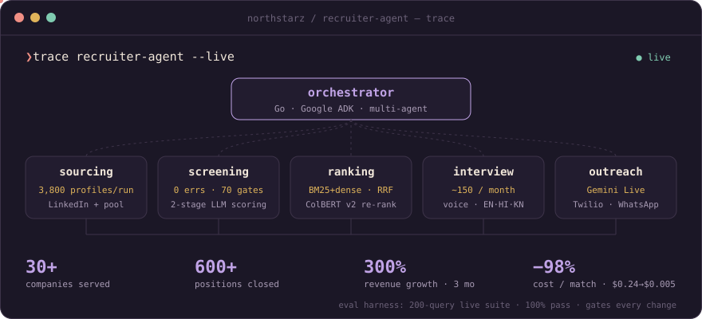
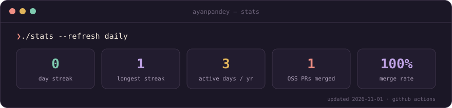

  

<h3><code>❯ trace recruiter-agent --live</code></h3>

<b>the long version</b>: what I build at Northstarz

 

- **Multi-agent recruiting assistant**: Go + Google ADK (migrated from LangChain). It handles sourcing, screening, outreach, evaluation and scheduling, and has helped 30+ companies close 600+ positions.
- **Candidate search**: Gemini embeddings in Qdrant, hybrid dense + BM25 with Reciprocal Rank Fusion, ColBERT v2 re-ranking and LLM scoring. A 200-query live eval suite gates every change.
- **Voice AI**: a Gemini Live calling agent over Twilio, a WebSocket AI interviewer in English, Hindi and Kannada, and a WebRTC interview room with Go signalling and a self-hosted TURN server.
- **AnthroSense**: 13 BiLSTM trait models trained in PyTorch and served from Go via ONNX, at zero per-call LLM cost.
- **Cost**: incremental scoring, Flex-tier inference and model routing cut talent-matching cost from $0.24 to $0.005 per match.

<h3><code>❯ ls ~/side-projects</code></h3>

| | project | what it does |
|---|---|---|
| 🧭 | [**job-application-agent**](https://github.com/ayanpandey/job-application-agent) | Finds matching jobs, tailors the resume per role (an auditor pass blocks factual drift), fills applications, drafts recruiter notes |
| 🕸️ | **Agent Hub** | Runs Claude, Codex and Gemini as one coding-agent pool: shared SQLite blackboard, deterministic routing, a "needs you" queue |
| 🎬 | **Hermes AI Reels Studio** | Topic in, published vertical reel out: Gemini script, Veo 3.1 clips, TTS, word-synced captions |
| 🐈‍⬛ | [**Void**](https://ayanpandey.xyz) | The cat-shaped guide on my portfolio: ask it anything about my work |
| 🔤 | [**nanoGPT**](https://github.com/ayan20186/nanoGPT) | GPT-2 from scratch in PyTorch, trained on Shakespeare |
| 🍲 | [**Novel Recipe Generation**](https://github.com/ayan20186/Novel-Recipe-Generation-Constraint-Optimization) | GPT-2 / Mistral / LLaMA-3 on 118k recipes, validated by actually cooking them |

<h3><code>❯ git log --since="1 year" | heatmap</code></h3>

<h3><code>❯ git log --merged --author=ayanpandey --not ~/own-repos</code></h3>

<!-- OSS:START -->
_First merged contributions coming soon._
<!-- OSS:END -->

<h3><code>❯ cat stack.txt</code></h3>

also: Google ADK · LangChain · ONNX · Vertex AI · Gemini · Qdrant · ColBERT · NATS JetStream · WebRTC · Twilio

<h3><code>❯ history | tail -3</code></h3>

<b>ML Engineer @ Wishfin</b>: loan-eligibility scoring that lifted partner-bank conversions 70% 
<b>Research Assistant @ MIDAS Lab, IIIT-Delhi</b>: YOLOv8 product-image extraction, 87% accuracy 
<b>B.Tech ECE @ IIIT Delhi</b>

  

void reviewed this README · 0 bugs found · cards redrawn daily by github actions

